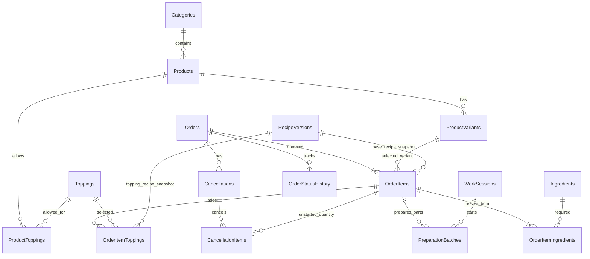
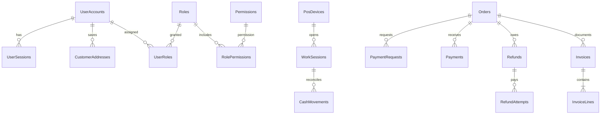
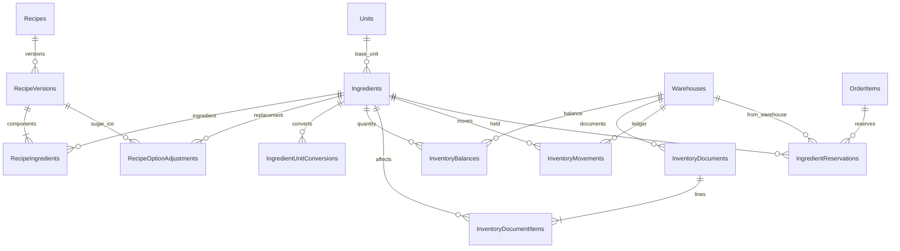
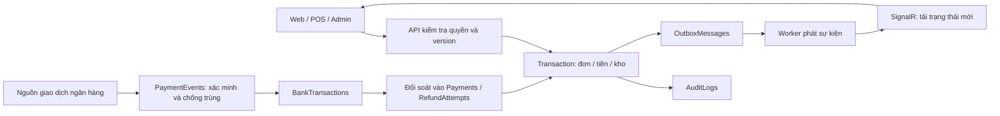

# Sơ đồ quan hệ database đề xuất

Các bảng metadata/quyền/tích hợp được mô tả đầy đủ trong từ điển. Ba sơ đồ dưới đây tập trung vào các quan hệ nghiệp vụ chính; dấu `?` trong từ điển là FK nullable. Các quan hệ vẽ dưới đây dùng các FK bắt buộc, tránh hiểu mọi Order đều phải thuộc Customer vì POS cho khách lẻ.

## 1. Menu, đơn và pha chế

## 2. Tài khoản, thiết bị và thu/hoàn

`Orders.CustomerUserId` nullable đối với POS; `Orders.WorkSessionId` nullable đối với Web. `Payments.BankTransactionId` nullable vì có CASH; khoản CK được xác minh phải liên kết giao dịch tin cậy. `RefundAttempts.BankTransactionId` liên kết chi ngân hàng khi có; không gộp “duyệt” và “chi thành công” làm một bước.

## 3. Công thức và kho

`InventoryMovements` có đúng một nguồn trực tiếp: dòng chứng từ kho **hoặc** batch pha; dùng hai FK nullable + CHECK XOR và các unique index phù hợp. Công thức có đúng một chủ sở hữu: ProductVariant hoặc Topping. Hai quan hệ loại trừ này được diễn giải bằng ràng buộc trong từ điển thay vì vẽ như hai FK đều bắt buộc.

## 4. Luồng dữ liệu vận hành

Sơ đồ thể hiện mô hình đề xuất, chưa có API hoặc database thật được tạo trong dự án giao diện.
